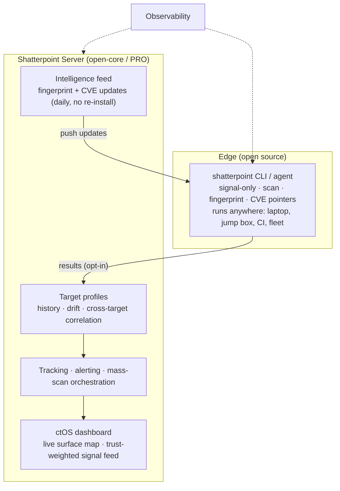

# shatterpoint — Vision

> **North star:** *the attack-surface intelligence you can trust* — a living, precise map of what a web target is and what's worth testing, that never cries wolf.

This document is a direction, not a commitment. It exists so the day-to-day work (signatures, precision fixes, CVEs) ladders toward something, and so we never accidentally trade away the one thing that makes shatterpoint worth building.

---

## Where we are today

shatterpoint is a **precision-first, signal-only web reconnaissance mapper** with a human-in-the-loop CVE-pointer layer. It:

- crawls a single target, fingerprints the stack, and maps the attack surface;
- names products (58+ signatures) and surfaces each one's famous CVE as a **"verify manually"** pointer;
- is **signal-only** — content-gated GET probes, never a payload, never asserts "vulnerable" (CI passivity guard enforces it);
- was hardened against real-world messiness (catch-all servers, path collisions, body-substring false positives) across a 69-service vulnerable-lab range.

Its defining trait is **discipline**: it would rather say nothing than lie. That is the foundation everything below is built on.

---

## The thesis

The web-recon space is crowded, but it's crowded with two kinds of tools:

1. **Coverage tools** that over-report (false positives, noise fatigue).
2. **Exploitation tools** that confirm-by-attacking (powerful, but not always legal/appropriate, and noisy).

There's a gap in the middle: **recon output you can actually trust, that maps cleanly to "what to test next," without exploiting anything.** That's the wedge. shatterpoint wins on *precision and trust*, not on signature count — and it must never forget that.

---

## What it becomes

Today it's a recon mapper with a CVE-pointer brain. The arc bends toward a **ctOS for your attack surface**: a backend brain that the lean CLI agents feed, that remembers targets over time, tells you what *changed*, retroactively flags new CVEs against what you already mapped, and shows it all on a calm, signal-only dashboard.

---

## Roadmap (sequenced — each phase earns the next)

> **The cardinal rule: the CLI has to win a community before the server is worth building.** Skipping ahead is the main failure mode.

### Phase 1 — The trusted edge *(now)*
A lean, fast, signal-only CLI that's the best *precise* web-recon tool in its niche. Win OSCP/OSWE/PG/HTB and authorized-pentest recon on reputation for never lying. Grow signatures + CVE pointers steadily.

### Phase 2 — The intelligence feed *(the unlock)*
Server-pushed **fingerprint + CVE-pointer updates**, like `nmap --script-updatedb` / `nuclei -update-templates`. New CVE drops → publish a pointer → every agent knows within minutes, no release. The community contributes to the **feed**, not the binary — coverage scales socially while the core stays lean and trusted. This is the recurring heartbeat that turns a tool into a service.

### Phase 3 — State: profiles, history, drift
Persist scans. Every IP/domain becomes a **living dossier** (stack, versions, exposures, history). Detect **drift** ("this host started exposing a Werkzeug debugger 40 min ago") and do **retroactive CVE matching** ("a new GeoServer CVE landed — you have 3 tracked hosts running it"). This is the jump from *stateless recon* (commodity) to *attack-surface intelligence* (sticky).

### Phase 4 — Continuous: tracking, alerting, orchestration
`shatterpoint watch <scope>` → continuous monitoring with push alerts on *new, confirmed* exposures only. Distribute scans across a **fleet of agents** (vantage points, rate-limits, scope control). Cross-target / fleet-wide exposure analysis.

### Phase 5 — The brain + the ctOS dashboard
The server UI: a **live map** of the surface (nodes = hosts, edges = shared cert/ASN/stack, color = trust-weighted exposure), dossier cards, and a **calm signal feed** that shows the handful of things that matter — not 10,000 findings. Plus observability over the agent fleet. The "shatter" motif as the visual language: a clean surface that fractures to reveal the precise weak point.

---

## Business shape: open-core

| Free / open source | Server / PRO |
|---|---|
| The CLI agent — the trust, the precision engine, the community | Orchestration, history, the intelligence feed, dashboards |
| Signatures + CVE pointers (contributable) | Team workspaces, scope management, **audit log** |
| Single-target, one-shot | Continuous tracking, fleet, drift/alerting, correlation |

Proven model (Tenable, ProjectDiscovery, GreyNoise, runZero). The open CLI is the funnel and the credibility; the server is the recurring value.

---

## Design invariants (must survive all growth)

These are the DNA. If a feature breaks one, it's the wrong feature.

1. **Signal over noise.** Never report what we can't stand behind. The dashboard shows the *few* things that matter, not everything.
2. **Signal-only, never exploit.** GET-only, content-gated, "verify manually." This is the legal/ethical moat *and* the brand. It scales all the way up the stack.
3. **Honest confidence.** Confidence reflects evidence strength. A definitive header is high; a lone substring is not. No inflation.
4. **Authorization is a feature.** Scope + audit log aren't enterprise polish — they're the grown-up form of the OSCP-legal DNA. Who scanned what, under what authority.
5. **Lean core, heavy edges in the feed.** Intelligence updates server-side; the agent stays small and stable.

---

## Non-goals (what we deliberately are *not*)

- **Not "the next nmap/nuclei."** That lane (coverage + scale) is taken; competing there plays to our weakness. We win on precision/trust, not breadth.
- **Not an exploitation framework.** We point; the human (or a downstream tool like nuclei) pulls the trigger.
- **Not a noisy scanner.** We'd rather surface 3 trustworthy signals than 300 maybes.

---

## Market read (honest)

The destination is the **offensive attack-surface-intelligence** category — which has incumbents (Shodan, Censys, Detectify, ProjectDiscovery Cloud, runZero). The defensible wedge that carries from CLI to platform: *precision-first, signal-only, authorized-recon-legal, with the recon→product→CVE bridge.* In a category drowning in false-positive fatigue, **"trust the signal"** is a real differentiator — and it's exactly the engine we've been hardening.

---

*A daydream with a ladder. Build the trusted edge first; the brain follows.*
